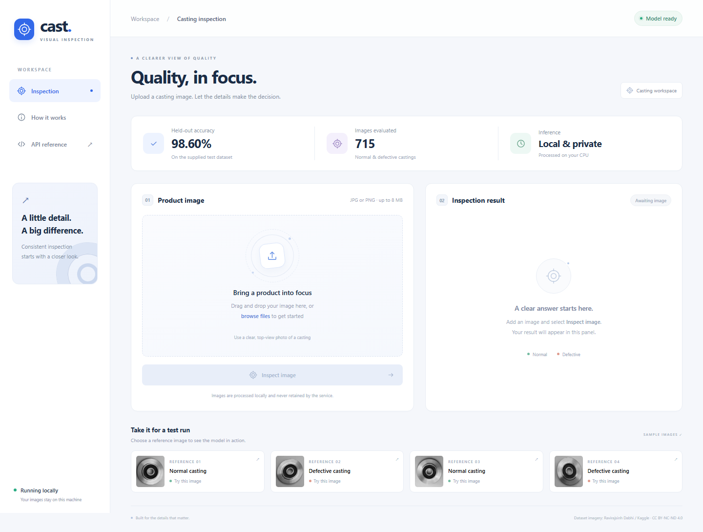

# Casting Defect Inspection

A reproducible visual inspection system that classifies pump-impeller casting
images as **Normal** or **Defective**, with a trained transfer-learning model,
FastAPI service, dataset audit, evaluation evidence and deployment files.

Start with [measured results](reports/RESULTS.md), the
[architecture diagram](docs/architecture.md), and the
[technical explanation](docs/technical_decisions.md). The
[assessment report](docs/assessment_report.pdf) provides a formatted overview
of the system, measured results and limitations.

## Recorded demonstration

**[Watch or download the recorded demonstration](https://github.com/Abdullah-Sarwar-MIrza/inspection-assessment/releases/download/assessment-demo/Technical-Skills-Assessment-Demo.mp4)**

Duration: **3 minutes 51 seconds**. The original MP4 is available through the
[GitHub release](https://github.com/Abdullah-Sarwar-MIrza/inspection-assessment/releases/tag/assessment-demo); it is hosted separately from Git source files
because its size exceeds GitHub's normal per-file Git limit.



## Setup and run

Use Python 3.12. The supplied `artifacts/model.pt` contains the complete model;
inference does not download pretrained weights or require the dataset.

```powershell
python -m venv .venv
.\.venv\Scripts\python.exe -m pip install -r requirements.txt
.\.venv\Scripts\python.exe -m uvicorn casting_inspector.api:app --host 127.0.0.1 --port 8000 --limit-concurrency 16
```

On Linux/macOS use `.venv/bin/python` in place of `.\.venv\Scripts\python.exe`.
Open **<http://127.0.0.1:8000/>** for the visual inspection workspace. Drag and
drop a JPG/PNG, preview it, select **Inspect image**, and review the result.
Reference images run a real prediction with one click. You can save the JSON
result, check model readiness and open a brief usage guide. All interface
assets are bundled locally, and the page uses the existing prediction API.

Open <http://127.0.0.1:8000/docs> for interactive API documentation.

```powershell
curl.exe -X POST http://127.0.0.1:8000/predict -F "file=@reports/examples/defective_1.jpg;type=image/jpeg"
.\.venv\Scripts\python.exe -m casting_inspector.predict reports/examples/normal_1.jpg
```

The response includes `predicted_class`, `confidence`, `defect_probability`,
`threshold`, `model_version`, `request_id` and `latency_ms`. See actual responses
in [HTTP evidence](reports/http_evidence.json) and
[example predictions](reports/example_predictions.json).

`Defective` is selected when the defect score is at least the stored threshold.
Confidence is the model score for the returned class. It is **uncalibrated**;
because the threshold may differ from 0.5, returned-class confidence can be below
0.5. It is not a measured probability of correctness or an out-of-distribution
detector.

## Dataset strategy

Source: Ravirajsinh Dabhi,
[casting product image data for quality inspection](https://www.kaggle.com/datasets/ravirajsinh45/real-life-industrial-dataset-of-casting-product).
The publisher credits PILOT TECHNOCAST, Shapar, Rajkot. Dataset license:
[CC BY-NC-ND 4.0](https://creativecommons.org/licenses/by-nc-nd/4.0/).
Images, example copies and visual reproductions retain that attribution and
license; the dataset is not included in the repository. The model is supplied
for this assessment and evaluation. Obtain suitable data rights and validate
on the target production line before commercial use.

The provided 300×300 collection contains 6,633 training images (3,758 defective,
2,875 normal) and 715 test images (453 defective, 262 normal). Decode every
image and audit dimensions, modes, class counts and pixel hashes. Remove exact
train duplicates, including any matching the supplied test set. Split the
remaining training pool 80/20 with seed 42 and stratified labels. Save every
assignment and hash in `reports/split_manifest.csv`. The supplied test set stays
held out during model and threshold selection.

The separate 512×512 source collection is excluded because its relationship to
the pre-augmented 300px images cannot establish independent physical products.
The upstream 300px dataset already includes augmentation. Pixel deduplication
and a dHash screening report do not eliminate rotated/augmented near duplicates.
There are no reliable part, batch, camera or time IDs, so these results measure
this image-level benchmark, not independent factory generalization.

## Model and training

ImageNet-pretrained ResNet-18 supplies a 512-value global pooled feature vector.
Keep the backbone frozen in evaluation mode and train a balanced, L2-regularized
logistic head on standardized features. The scaler sees only training features.
The final scaler and classifier coefficients are embedded in a Torch model,
so serving has no scikit-learn dependency or pickle estimator.

Convert grayscale/RGB inputs to RGB, resize the entire image to 160×160 without
cropping, and apply ImageNet channel normalization. The lower resolution is a
CPU latency compromise and may obscure tiny defects. Each training image also
gets one deterministic mirrored view with a small ±8° rotation. Validation and
test receive no augmentation. The head uses inverse-frequency class weights;
there is no synthetic oversampling of the validation or test sets.

Choose regularization `C` from `[0.001, 0.01, 0.1, 1, 10]` and thresholds from
0.10 to 0.90 in steps of 0.02 using validation only. Maximize defect F2 subject
to at least 95% validation precision; fall back to maximum F2 if infeasible.
F2 gives recall more weight because a missed defective part can escape inspection.
The precision floor is an explicit assessment assumption, to be replaced by
the client's actual scrap/rework/escape costs. Do not adjust this threshold
after reading test results. No validation refit is performed.

Download/extract the Kaggle dataset yourself into this layout:

```text
casting_data/casting_data/
  train/ok_front/*.jpeg
  train/def_front/*.jpeg
  test/ok_front/*.jpeg
  test/def_front/*.jpeg
```

```powershell
.\.venv\Scripts\python.exe -m pip install -r requirements-dev.txt
.\.venv\Scripts\python.exe -m casting_inspector.train --data casting_data/casting_data --seed 42 --threads 4
.\.venv\Scripts\python.exe scripts/validate_and_report.py
.\.venv\Scripts\python.exe -m pytest -q
```

The first training run downloads standard ResNet-18 weights. Training overwrites
artifacts and reports; keep a copy before experimenting. Feature caches are
keyed by ordered pixel hashes, paths and preprocessing/augmentation recipe.
Delete `reports/cache` to force extraction. Exact numerical reproducibility may
vary across library versions or hardware; pinned direct dependencies and the
recorded environment help reproduce this run.

## Evaluation and limitations

Read [RESULTS.md](reports/RESULTS.md) for measured precision, recall, F1, confusion
matrix, ROC AUC, average precision and measured CPU HTTP latency. Full validation
candidates and bootstrap intervals are in `reports/metrics.json`. A majority
class predictor is the baseline. All 715 individual test predictions are in
`reports/test_predictions.csv`; false positives/negatives are separately listed
in `reports/errors.json`. [Error analysis](docs/error_analysis.md) discusses the
observed failures and their operational consequences.

This binary classifier does not locate defects, identify defect types, inspect
hidden surfaces or guarantee that an unrelated uploaded image is a casting.
Scores are not calibrated, and validation/test come from a single constrained
camera/domain with uncertain product independence. New lighting, orientation,
part geometry, motion blur and new defect types need prospective testing.
No factory operating threshold or SLA is established by this assessment.

## Optional Docker deployment and maintenance

See the [Docker operating guide](docs/docker_guide.md) for startup, image
uploads, health checks, logs, shutdown and troubleshooting.

```powershell
docker compose up --build -d
curl.exe http://127.0.0.1:8000/health/ready
docker compose logs -f
docker compose down
```

The default host port is 8000. If another local server uses it, put
`INSPECTOR_PORT=8001` in a local `.env` file before starting Compose, then open
<http://127.0.0.1:8001/> and use port 8001 for health/inference requests.

The container runs as a non-root user with a read-only filesystem, a bounded
temporary directory, CPU/memory limits and one Uvicorn worker. It loads a local
SHA-256-checked artifact at startup and warms up inference. Serving uses two
Torch threads, one active model call, and a concurrency limit of 16. Scale
replicas after measuring representative load. The Docker image built successfully, became healthy and returned a real image
prediction through the container API. Evidence is recorded in
`reports/docker_verification.json`; see `docs/verification.md` for the scope.

The service rejects unsupported media, malformed/truncated images, files above
8 MiB, requests above the multipart body limit, images below 32px in either
dimension, and images above 16 megapixels. Raw uploads are not retained or
logged. Request IDs, HTTP status and timings support troubleshooting. Startup
fails on missing or corrupt model files; `/health/live` and `/health/ready`
support process and readiness probes. `MODEL_DIR` and `TORCH_THREADS` are
environment settings. For external access, put an authenticated TLS reverse
proxy in front, set body/read timeouts and rate limits, and monitor latency,
5xx/422 rates, defect-rate drift and sampled operator-reviewed mistakes.

Version weights and metadata together, keep the previous pair for rollback,
and deploy replacements through a held-out regression check and shadow run.
Collect reviewed failures and batch/part IDs for retraining. Fixing an observed
test failure requires a new validation experiment and a fresh independent test
set for an unbiased final estimate.

## Project map

| Location | Purpose |
|---|---|
| `casting_inspector/train.py` | Audit, split, augment, train, select, evaluate |
| `casting_inspector/model.py` | Shared decoder, preprocessing and inference |
| `casting_inspector/api.py` | Upload API, lifecycle, health, validation/logging |
| `artifacts/` | Complete trained model and metadata |
| `reports/` | Manifest, metrics, predictions, plots, live HTTP evidence |
| `docs/` | Architecture, decisions, errors, report and submission checklist |
| `tests/` | Real model/API consistency, upload boundaries and split isolation |
| `scripts/` | API/report verification and browser checks |

Framework references: [Torchvision ResNet-18](https://docs.pytorch.org/vision/stable/models/generated/torchvision.models.resnet18.html),
[scikit-learn logistic regression](https://scikit-learn.org/stable/modules/generated/sklearn.linear_model.LogisticRegression.html),
[FastAPI uploads](https://fastapi.tiangolo.com/tutorial/request-files/).

## Browser interface verification

The interface was checked in local Chrome on desktop and mobile widths with
real predictions, uploads, drag and drop, downloads and failure/recovery states.
See `reports/ui-verification.json`. To repeat: install `playwright==1.64.0`
and run `python scripts/verify_ui.py` with Chrome or Edge installed. The script
starts and cleans up its own local server.

The formatted PDF can be regenerated from the saved results without starting
any service: `python scripts/validate_and_report.py --report-only`.
