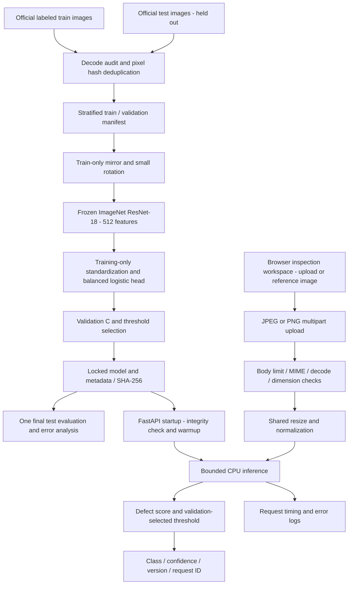

# Architecture

Training and inference share `casting_inspector/model.py`. The deployed model
contains the feature extractor, normalization buffers and trained head. Serving
does not require scikit-learn, network downloads or access to the dataset.

One process with two Torch threads and one active model call bounds CPU
contention. Uvicorn bounds concurrent connections; run additional replicas for
throughput after load testing. Readiness follows successful artifact loading;
liveness confirms that the process responds. A reverse proxy should terminate
TLS, authenticate clients, rate-limit requests and enforce an upload timeout.
