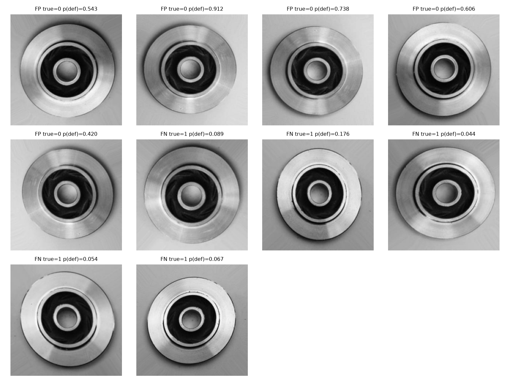

# Error analysis of the locked test evaluation

The 715 test images produce **5 false positives** and **5 false negatives**.
Labels treat Defective as positive. Confusion counts are TN=257, FP=5, FN=5,
TP=448. False-positive rate is 5/262 = 1.91%; false-negative rate is
5/453 = 1.10%. Every mistake and its score appears in
[`reports/errors.json`](../reports/errors.json). This analysis follows model
selection; none of these mistakes was used to retune the submitted model.

The observations below are visual inspection of the supplied images. They are
hypotheses about failure mechanisms, not operator-confirmed defect annotations
or evidence that the model attended to a particular region.

| Test image | Error | Defect score | Visual observation |
|---|---|---:|---|
| `cast_ok_0_1207.jpeg` | FP | 0.543 | Smooth overall ring; a small boundary irregularity and reflection at the lower/right edge could resemble defective examples. |
| `cast_ok_0_259.jpeg` | FP | 0.912 | Strong diagonal highlight/texture across an otherwise regular ring. This is a confident mistake despite the supplied Normal label. |
| `cast_ok_0_7839.jpeg` | FP | 0.738 | Small surface marks and subtle outer-boundary variation; the exact ground-truth inspection criterion is unavailable. |
| `cast_ok_0_942.jpeg` | FP | 0.606 | Bright banding and contrast variation near the inner/outer ring; no gross defect is obvious in the overview. |
| `cast_ok_0_9926.jpeg` | FP | 0.420 | Mostly regular ring with faint machining/lighting texture; closest FP to the 0.36 decision boundary. |
| `cast_def_0_1591.jpeg` | FN | 0.089 | Outer-edge contour variation is subtle compared with the large smooth surface. |
| `cast_def_0_1607.jpeg` | FN | 0.176 | Low-contrast irregular outer rim against a pale background; highest score among the five misses. |
| `cast_def_0_2154.jpeg` | FN | 0.044 | Localized rim irregularities occupy little image area; global pooled features may underrepresent them. |
| `cast_def_0_2483.jpeg` | FN | 0.054 | Visible localized roughness/nicks along the upper outer boundary, while the main circular structure appears regular. |
| `cast_def_0_3105.jpeg` | FN | 0.067 | Upper-rim roughness contrasts with an otherwise regular part; the model still gives a low defect score. |

False positives imply unnecessary rejection or manual review of good parts.
False negatives pass bad parts downstream. All five misses have defect scores
below 0.18; a narrow review band around the 0.36 threshold would not catch them.
The largest FP score is 0.912. These confident errors show why confidence alone
cannot establish quality, safety, calibration, or novelty detection.

Resizing to 160px can weaken small rim defects. Frozen ImageNet features and
global average pooling can favor overall appearance over tiny localized
irregularities. Surface texture, illumination and label ambiguity are plausible
contributors. We have neither localization labels nor manufacturing acceptance
rules, so a domain expert should review these ten cases before asserting root
causes or correcting labels.

For a subsequent experiment, collect operator-reviewed examples with physical
part and batch IDs. Compare higher input resolution and fine-tuning the final
backbone block on a new validation set. Check lighting robustness and blur;
consider a separate boundary-detail branch or annotated defect detector when
localized defects dominate. Estimate rejection/escape costs and calibrate scores
on a separate representative set. Evaluate the resulting policy on a fresh
batch/time-separated test set rather than repeatedly optimizing these 715 images.

The dataset audit flags **566/715 test images** with a training dHash within four
bits. Similar round, aligned castings can have similar hashes even when they are
different parts. This is a screening signal rather than a count of proven
duplicates. Combined with the publisher's pre-augmentation and missing part
IDs, it means the image-level score may be optimistic for unseen production
parts. Exact pixel overlap is removed from training, but no claim of complete
near-duplicate removal or physical-part independence is made.

Source images: Ravirajsinh Dabhi / Kaggle, with acknowledgement to PILOT
TECHNOCAST. Dataset imagery retains CC BY-NC-ND 4.0; figure resizing and labels
are for inspection of this noncommercial assessment.
